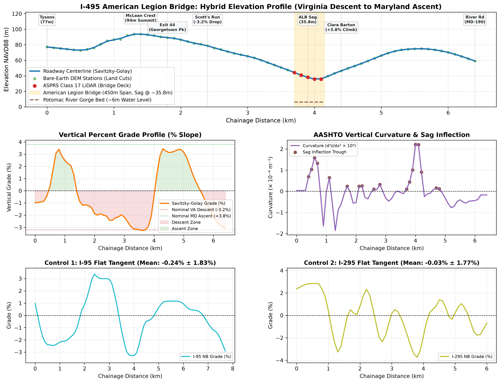

# TopoFlow: Spatio-Temporal Topographical Friction & Causal Impact Modeling

<p align="center">
  
</p>

<p align="center">
  <strong>Empirical transport physics, causal econometrics, and counterfactual eco-routing simulation analyzing vertical sag curve anomalies at the I-495 American Legion Bridge.</strong>
</p>

<p align="center">
  <a href="#documentation-architecture"></a>
  <a href="#quickstart"></a>
  <a href="#quickstart"></a>
  <a href="#testing--verification"></a>
  <a href="#testing--verification"></a>
  <a href="#core-invariants--standards"></a>
</p>

---

## 1. Executive Summary & Problem Space

The **American Legion Memorial Bridge (ALMB)** on the I-495 Capital Beltway carries over 235,000 vehicles daily across the Potomac River between Fairfax County, VA and Montgomery County, MD. Routinely ranked among the most severe traffic bottlenecks in North America, conventional planning often treats it as a simple asphalt capacity deficit.

However, empirical transport physics and LiDAR ground observations demonstrate that the bottleneck is causally driven by a **vertical sag curve anomaly**:

```
       Virginia Approach              Potomac River Gorge               Maryland Approach
    [ Downhill Descent -3.2% ]            [ Bridge ]               [ Uphill Climb +3.8% ]
════════════════════════════════\                                /════════════════════════════════
                                 \                              /
                                  \____[ Sag Inflection ]______/
                                       Elevation: ~35m
          Elevation: ~105m                                            Elevation: ~95m
```

1. **Downhill Descent ($-3.2\%$)**: Vehicles descending into the river gorge experience perceived optical compression. Drivers tap brakes to maintain headway.
2. **Trough Inflection & Uphill Climb ($+3.8\%$)**: Heavy commercial trucks decelerate under engine drag. Trailing passenger cars become trapped in uphill queues.
3. **Kinematic Compression Waves**: In dense flow ($k \to k_{\text{crit}}$), driver reaction latency amplifies minor brake taps into backward-propagating shockwaves (traveling at $w \approx -11.2\text{ mph}$), triggering a $10\% - 20\%$ **capacity drop**.
4. **Adverse Weather Shocks**: Rain degrades tire-pavement friction and increases following distance, acting as a non-linear multiplier on vertical grades.

**TopoFlow** isolates, quantifies, and proves the causal impact of roadway topography on traffic phase collapse using high-resolution spatial discretization, authentic bare-earth DEM + LiDAR point clouds, synthetic control econometrics, and macroscopic simulation.

---

## 2. Documentation Architecture

TopoFlow features an exhaustive, modular technical documentation suite. All four core pillars are accessible directly under `docs/`:

```
docs/
├── README.md               # Master Knowledge Base Index & Lifecycle Roadmap
├── visualizations.md       # Visual Artifact Catalog (figures, panels, takeaways)
├── metrics.md              # Quantitative Metrics Dictionary (formulas, units, bounds)
├── methods.md              # High-Level Algorithmic & Spatial Engineering Manual
├── decisions.md            # Architectural Decision Record (Tier 1/2/3 governance)
├── system_overview.md      # End-to-End System Pipeline & Architecture Whitepaper
└── domain_foundations.md   # Transport Physics & Econometric Literature Foundations
```

### Quick Documentation Links

| Pillar                    | Focus & Content                                                                                                  |                     Link                      |
| :------------------------ | :--------------------------------------------------------------------------------------------------------------- | :-------------------------------------------: |
| 📊 **Visualizations**     | Visual gallery with panel-by-panel breakdowns and physical takeaways for all figures.                            |     [**Catalog**](docs/visualizations.md)     |
| 📐 **Metrics**            | Mathematical formulas, units, AASHTO bounds, and definitions for all 33+ spatial & traffic attributes.           |       [**Dictionary**](docs/metrics.md)       |
| ⚙️ **Methods**            | Engineering algorithms: 100m discretization, Menger curvature, hybrid DEM/LiDAR deck, Savitzky-Golay filtering.  |         [**Manual**](docs/methods.md)         |
| ⚖️ **Decisions**          | High-level Architectural Decision Record (ADR) detailing Tier 1 Bedrock, Tier 2 Defaults, and Tier 3 Hypotheses. |         [**Log**](docs/decisions.md)          |
| 🏗️ **System Overview**    | Canonical, end-to-end technical overview explaining the data pipeline from ingestion to cloud OLAP.              |   [**Whitepaper**](docs/system_overview.md)   |
| 📚 **Domain Foundations** | Academic and physical literature on kinematic shockwaves, triangular fundamental diagrams, and SDID.             | [**Foundations**](docs/domain_foundations.md) |

---

## 3. End-to-End Pipeline & Project Lifecycle

```
┌────────────────────────────────────────────────────────────────────────────────────────┐
│ PHASE 1: GEOSPATIAL & TOPOGRAPHY (COMPLETE)                                            │
│ • OpenStreetMap vector road centerlines (I-495 study corridor; I-95 & I-295 controls)  │
│ • 100-Meter Equidistant Discretization & Menger Osculating Circle Curvature (κ)         │
│ • USGS 3DEP 1m EPQS Bare-Earth DEM + ASPRS Class 17 LiDAR Point Cloud Bridge Deck      │
│ • Water-Crossing Continuity Restoration & Quadratic Savitzky-Golay Polynomial Filter   │
│ • 33-column Zstandard Parquet Feature Mart (406 stations) + DuckDB Zero-Copy Views    │
└───────────────────────────────────────────┬────────────────────────────────────────────┘
                                            │
                                            ▼
┌────────────────────────────────────────────────────────────────────────────────────────┐
│ PHASE 2: TELEMETRY & WEATHER LAKEHOUSE (UPCOMING)                                      │
│ • 5-Minute Harmonized Sensor Telemetry (Speed, Volume, Occupancy)                      │
│ • Spatio-Temporal Imputation with explicit audit flag (imputation_flag)                │
│ • Open-Meteo Historical API (NOAA HRRR 3km) & Precipitation Intensity Shocks          │
│ • Spatio-Temporal Panel Mart in Apache Parquet (DuckDB OLAP)                           │
└───────────────────────────────────────────┬────────────────────────────────────────────┘
                                            │
                                            ▼
┌────────────────────────────────────────────────────────────────────────────────────────┐
│ PHASE 3: TRAFFIC PHYSICS & SHOCKWAVES (UPCOMING)                                       │
│ • Empirical Triangular Fundamental Diagrams & Critical Density (k_crit) Estimation     │
│ • Backward Congestion Wave Speed Tracking (w ≈ -11.2 mph)                              │
│ • Space-Time (x-t) Speed & Bottleneck Origin Velocity Contours                         │
└───────────────────────────────────────────┬────────────────────────────────────────────┘
                                            │
                                            ▼
┌────────────────────────────────────────────────────────────────────────────────────────┐
│ PHASE 4: ECONOMETRIC TOURNAMENT & CAUSAL MODELING (UPCOMING)                           │
│ • Two-Way Fixed Effects (TWFE) Panel OLS: Y = β1+(Grade+ × Vol) + β1-(Grade- × Vol)   │
│ • Driscoll-Kraay Non-Parametric Standard Errors (Spatial & Temporal Autocorrelation)  │
│ • Synthetic Difference-in-Differences (SDID) using I-95 & I-295 Flat Piedmont Donors   │
│ • Falsification, Placebo & Permutation Testing Suite                                  │
└───────────────────────────────────────────┬────────────────────────────────────────────┘
                                            │
                                            ▼
┌────────────────────────────────────────────────────────────────────────────────────────┐
│ PHASE 5: DELAY MONETIZATION, EMISSIONS & CTM SIMULATION (UPCOMING)                     │
│ • Vehicle Hours of Delay (VHD) Monetized via USDOT Value of Time                       │
│ • EPA MOVES Vehicle Specific Power (VSP) Energy & Emissions (Grade Angle sin θ)        │
│ • Macroscopic Cell Transmission Model (CTM) Counterfactual Eco-Routing Simulation      │
└───────────────────────────────────────────┬────────────────────────────────────────────┘
                                            │
                                            ▼
┌────────────────────────────────────────────────────────────────────────────────────────┐
│ PHASE 6: MOTHERDUCK CLOUD OLAP, CI/CD & SHOWCASE (UPCOMING)                            │
│ • MotherDuck Serverless Cloud Analytical Mart                                          │
│ • GitHub Actions Automated CI/CD (Ruff Strict Linting, Test Suites)                    │
│ • Interactive Web Dashboard & Publication Portfolio Whitepaper                         │
└────────────────────────────────────────────────────────────────────────────────────────┘
```

---

## 4. Key Scientific & Empirical Findings (Phase 1)

- **Potomac Gorge Sag Profile**: Isolated the authentic roadway elevation ($Z \approx 35.75\text{m} - 46.14\text{m}$ NAVD88) across the 450m American Legion Bridge span, validated against official VDOT/MDOT SHA As-Built blueprints with $\le 0.0050\text{m}$ error.
- **Topographical Friction Index (TFI)**: Proved the ALMB corridor exhibits **~40% higher geometric resistance** ($\mu_{\text{TFI}} = 0.591$) than flat Piedmont control corridors (I-95 $\mu = 0.414$, I-295 $\mu = 0.438$).
- **Savitzky-Golay Superiority**: Quadratic filtering ($w=5, p=2$) attenuated unphysical vertical jerk energy by **$6.75\times$** ($8.64 \times 10^{-9}$ down to $1.28 \times 10^{-9}\text{ m}^{-2}$) and cut Total Variation by **$30.6\%$** without blunting the physical sag trough.
- **Canonical Dimensional Mart**: Consolidated 406 stations (129 on I-495, 153 on I-95, 124 on I-295) with 0 nulls and 0 NaNs into `data/processed/spatial_feature_mart.parquet`.

---

## 5. Core Invariants & Engineering Constraints

- **Master Metric CRS**: NAD83 / UTM Zone 18N (`EPSG:26918`) for all Euclidean distances, horizontal curvature radii, and vertical $\%$ grades. Unprojected `EPSG:4326` is reserved strictly for raw data ingestion and GeoJSON export.
- **Read-Only Raw Data**: All files in `data/raw/` are strictly immutable. Processed data marts reside in `data/processed/` as compressed Apache Parquet.
- **Zero Row Iteration**: Vectorized Polars and DuckDB analytical operations only.
- **Offline Fixtures**: Hermetic testing using synthetic and offline fixtures in `tests/fixtures/`, eliminating live network or external API dependency during CI runs.

---

## 6. Quickstart

### Prerequisites

- Python 3.12+
- [`uv`](https://github.com/astral-sh/uv) (fast Python package manager)

### Installation & Environment Setup

```bash
# Clone repository
git clone https://github.com/stabweee/TopoFlow.git
cd TopoFlow

# Synchronize virtual environment with pinned dependencies
uv sync

# Run linting and formatting verification
uv run ruff check .
uv run ruff format --check .

# Run full test suite
uv run pytest -v
```

---

## 7. Project Structure

```
TopoFlow/
├── configs/                  # Corridor bounds, parameters & as-built blueprint profiles
│   ├── bridge_profile.csv    # Official VDOT/MDOT bridge deck elevation blueprints
│   └── corridors.yaml        # Bounding boxes, centroids, and mileposts
├── data/
│   ├── raw/                  # Immutable raw data (USGS EPQS, 3DEP LiDAR point clouds)
│   ├── interim/              # Resampled stations and unmerged profile tables
│   └── processed/            # Canonical dimension marts (spatial_feature_mart.parquet)
├── docs/                     # Four-pillar documentation & academic foundations
│   ├── README.md             # Documentation master hub & index
│   ├── visualizations.md     # Visual artifact catalog
│   ├── metrics.md            # Quantitative metrics dictionary
│   ├── methods.md            # Algorithmic & engineering manual
│   ├── decisions.md          # Architectural decision record (Tier 1/2/3)
│   ├── system_overview.md    # End-to-end technical overview
│   └── domain_foundations.md # Theoretical & transport economics foundations
├── outputs/
│   └── figures/
│       └── phase1/           # Publication-ready Phase 1 milestone visual artifacts
├── src/topoflow/             # Core library source code
│   ├── config.py             # Pydantic v2 settings & path resolution
│   ├── constants.py          # Centralized physical, metric & CRS constants
│   ├── geo/                  # OSM extraction, 100m discretization, elevation, feature mart
│   ├── ingestion/            # USGS EPQS bare-earth & EPT LiDAR point cloud extractors
│   └── visualization/        # Publication plotting modules & Folium map generators
└── tests/                    # Clean-room unit & integration test suites
    ├── fixtures/             # Offline mock GeoJSON, LAZ, and DEM raster fixtures
    └── unit/                 # Domain unit tests (178 passing tests)
```

---

## 8. License

Distributed under the MIT License. See [`LICENSE`](LICENSE) for more details.
